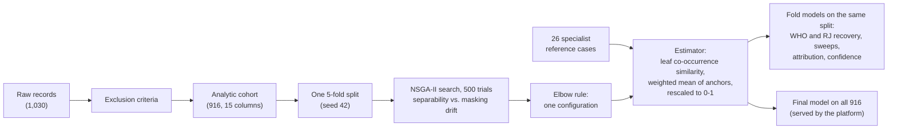

# Leprosy spectrum position

Code for the doctoral thesis *Explainable and reproducible classification of
leprosy using the classic Ridley-Jopling system: a case-anchored computational
model* (Eduardo Ferreira José Heise, Pontifícia Universidade Católica do
Paraná, 2026).

The Ridley-Jopling classification places a leprosy patient on a spectrum from
the tuberculoid pole (TT) through the borderline classes (BT, BB, BL) to the
lepromatous pole (LL). This repository estimates that place as a single
number between 0 and 1, the **position**, from the findings a clinician
records: lesion count, colour and type, reaction history, anti-PGL-1 titre,
bacilloscopy and histology. Any of them may be missing.

The position is read against 26 reference cases that leprosy specialists
described for the TT, BB and LL classes. A tree ensemble trained on 916
labelled records from three Brazilian reference centres decides how similar a
patient is to each reference case, and the position is the similarity-weighted
mean of the reference cases' anchors (TT 0, BB 0.5, LL 1). Each position comes
with a confidence band for the tests the record lacks, and with a breakdown of
how much each finding moved it.

## The method in brief



1. **Cohort.** Exclusion criteria from the literature remove records whose
   label contradicts their own findings, and records with neither bacilloscopy
   nor histology: 1,030 records become 916.
2. **Estimator.** A tree ensemble is trained on the Ridley-Jopling labels. The
   similarity between a record and a reference case is the share of trees in
   which they fall in the same leaf. The raw position is the
   similarity-weighted mean of the reference anchors, and it is mapped
   linearly onto [0, 1] over every combination of findings that can be
   recorded.
3. **Search.** The backbone (LightGBM, XGBoost, CatBoost, random forest), the
   model type (regression on the class targets, or multiclass over the five
   classes; `target_head` in the code), the missing-value strategy and the
   hyperparameters are searched together by NSGA-II on two objectives: class-balanced error
   against the class targets, and how far the position drifts when findings
   are hidden. An elbow rule picks one configuration from the Pareto front.
4. **Results.** The selected configuration is refitted on the same five folds,
   and every result is read on held-out records: recovery of the WHO and
   Ridley-Jopling classes, the response to each finding, per-finding
   attribution (Tree Similarity SHAP) and the confidence band.
5. **Final model.** The configuration fitted on all 916 records is the model
   the clinical platform serves. It is not used for any evaluation.

[docs/method.md](docs/method.md) gives the protocol and the equations.

## Quick start

The project uses [uv](https://docs.astral.sh/uv/) and Python 3.12. The Tree
Similarity SHAP package (`shapley-values`) is a path dependency and must be
checked out next to this repository, as `../shapley_values`.

```
uv sync
uv run pytest                     # synthetic data only; no patient data needed
uv run python main.py all         # needs the cohort in data/raw/
```

The pipeline has three stages, which hand over through files on disk:

```
uv run python main.py preprocess                      # data/raw -> data/processed
uv run python main.py experiments                     # data/processed -> results
uv run python main.py reports                         # results -> reports
uv run python main.py experiments --only confidence   # one step of a stage
```

A step that lacks an input stops and names the step that writes it.
[docs/pipeline.md](docs/pipeline.md) lists every step, the files it reads and
writes, and how long it takes.

## Plugging in the data

The cohort is individual patient data and is not in this repository. It is
available on request from the authors, under the study's ethics approval. To
run the pipeline, place the workbook `rafa_total.xlsx` in `data/raw/`;
[data/raw/README.md](data/raw/README.md) and [docs/data.md](docs/data.md)
describe the expected columns. The 26 reference cases are not patient data
and are included, in `data/reference_cases/prototypes.xlsx`.

`data/raw/`, `data/processed/` and `results/` are excluded from version
control, so nothing derived from patient records can be committed by
accident. The published outputs in `reports/` (figures, tables and
`numbers.json`) are aggregates from the real run.

## Folder guide

| Folder | What it holds |
|---|---|
| `main.py` | Runs the stages and steps in order |
| `config.yaml` | Every constant: seeds, folds, trial count, search space, draws, coverage levels |
| `data/raw/` | The patient workbook (not tracked) and a README on its columns |
| `data/reference_cases/` | The 26 specialist reference cases (tracked) |
| `data/processed/` | Written by `preprocess`: cohort, reference cases, schema, exclusion audit, folds, variable screen (not tracked) |
| `preprocessing/` | One module per preprocessing step |
| `experiments/` | One module per experiment |
| `results/` | Written by `experiments`: search study, selected configuration, held-out positions, attribution, confidence, final model (not tracked) |
| `reports/` | Written by `reports`: `figures/`, `tables/`, `numbers.json`, and a [README](reports/README.md) mapping each item to the thesis |
| `src/leprosy_similarity/` | The library: schema, cohort, estimator, rescaling, search, cross-validation, attribution, confidence; `reports/` has one module per figure or table group |
| `tests/` | pytest on small synthetic fixtures generated in code |
| `docs/` | [method](docs/method.md), [data](docs/data.md), [pipeline](docs/pipeline.md), [reproducibility](docs/reproducibility.md) |

## Reproducibility

Every random choice is seeded from `config.yaml`, the numerical libraries are
pinned in `uv.lock`, and a rerun reproduces every output, except that the
search's LightGBM trials can move in the fifth decimal (thread-order
summation), which shifts the design-axis importances by less than 0.001.
The full configuration search takes about 13 hours; everything else takes
minutes. See [docs/reproducibility.md](docs/reproducibility.md).

## Licence

MIT; see [LICENSE](LICENSE).

## How to cite

Please cite the thesis:

```bibtex
@phdthesis{heise2026leprosy,
  author = {Heise, Eduardo Ferreira Jos{\'e}},
  title  = {Explainable and Reproducible Classification of Leprosy Using the
            Classic {Ridley--Jopling} System: A Case-Anchored Computational Model},
  school = {Pontif{\'i}cia Universidade Cat{\'o}lica do Paran{\'a}},
  address = {Curitiba, Brazil},
  year   = {2026},
  type   = {Doctoral thesis, Programa de P{\'o}s-Gradua{\c{c}}{\~a}o em Ci{\^e}ncias da Sa{\'u}de}
}
```
